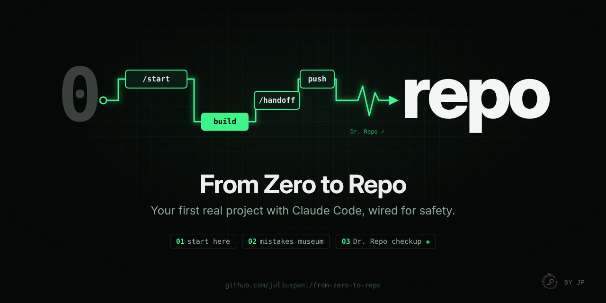

**English** · [Español](#resumen-en-español)

# From Zero to Repo

**Your first real project with Claude Code, safely.**

> Community project. Not affiliated with Anthropic.

Never used git, GitHub or Claude Code? This takes you from nothing installed to a real project online, with an
AI agent that works inside rules it cannot break. At the end you will have your own repository, your first
pushes, and a way of working where every session starts where the last one ended.

## Already have a project? Let Dr. Repo take a look.

Dr. Repo is a read-only check-up: it never changes a file, never uses the network and never runs anything from
the project it examines. Inside a copy of this repo it is `npm run dr-repo`; for any other project, point it at
the folder (for a project from someone else, `git clone` it rather than copying the folder):

```bash
git clone https://github.com/juliuspani/from-zero-to-repo
node from-zero-to-repo/dr-repo.mjs path/to/your/project --prompt
```

It scores 10 protections (secrets, git email, rules for the agent, guardrails), and for each one that is
missing it tells you how to fix it, why it matters, and a prompt to paste in Claude Code that fixes it safely.

## The path

| | |
|---|---|
| **[Level 0: Start here](docs/start-here.md)** | Twelve words, explained like a friend would, and the session loop in one picture. 5 minutes. |
| **[Level 1: Your first session in 10 steps](docs/first-session.md)** | From zero to your first push, with a tiny [example project](examples/todo-cli/) so you never face a blank page. |
| **[Mistakes Museum](docs/mistakes-museum.md)** | Real mistakes, told as short stories: what happened, why, what prevents it now, and the test that proves it. |
| **[Prompts that worked](docs/prompt-patterns.md)** | Eight patterns, each with a bad prompt, a good one and why. |
| **[Cheatsheet](docs/cheatsheet.md)** | `/start`, `/handoff`, when to clear, one step per session. |
| **[Level 2: Training Wheels for your agent](docs/level-2.md)** | **Optional.** The guard hook, permissions, read-only reviewers and the rules behind them, already set up in this template. Levels 0 and 1 work without reading it. |

Use it: click **Use this template** on GitHub, or follow [step 5](docs/first-session.md).

## Real example: how I built JP Quant as a student

I built [JP Quant](https://github.com/juliuspani/jp-quant), a crypto-strategy research platform, with Claude Code
and this method: dozens of steps, one per session, each closed with a handoff. It has close to 800 automated
tests, 49 written decisions, and three public versions. Its most useful result was an honest "no": the best
strategy failed criteria frozen in advance. The story is in [STORY.md](https://github.com/juliuspani/jp-quant/blob/main/STORY.md).
The cards in the museum come from building it, and from preparing this repo.

## Contributing

Questions are contributions. If a step confused you, [open an issue](../../issues): beginner questions are
exactly what this repo is for. Lived a mistake worth a museum card? Propose it with the four parts: what
happened, why, what prevents it, the proof.

## License

[MIT](LICENSE). Community project, not affiliated with Anthropic. "Claude" and "Claude Code" are names of
Anthropic's products, used here only to say what this guide is about.

## Resumen en español

**From Zero to Repo** te lleva de no tener nada instalado a tu primer proyecto real con Claude Code, publicado y
seguro. Funciona con un ciclo sencillo: `/start` → un paso → `/handoff` → `/clear`. **Dr. Repo**
(`node dr-repo.mjs <ruta> --prompt`) revisa cualquier proyecto sin cambiar nada y te dice cómo arreglar cada
fallo. El **museo de errores** cuenta los errores reales del proyecto en el que nació este método, con la
prueba que demuestra que ya no pasan. El **nivel 2** (opcional) añade ruedines para el agente: un hook de
guarda, permisos y revisores de solo lectura.

En español: [Nivel 0: Empieza aquí](docs/es/start-here.md) · [Nivel 1: Tu primera sesión en 10 pasos](docs/es/first-session.md) ·
[Museo de errores](docs/es/mistakes-museum.md) · [Chuleta](docs/es/cheatsheet.md). El resto (los patrones de prompt y el
nivel 2) está en inglés. Proyecto comunitario, sin afiliación con Anthropic.
