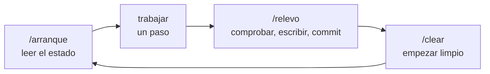

[English](../start-here.md) · **Español**

# Nivel 0: Empieza aquí

Doce palabras que vas a oír todo el rato, explicadas como lo haría un amigo. Cinco minutos. Cuando quieras la
versión completa, cada una enlaza a la documentación oficial.

| Palabra | En palabras sencillas | Ejemplo de la vida real |
|---|---|---|
| **Repo** (repositorio) | Una carpeta de proyecto que recuerda todas sus versiones. | Un cuaderno en el que puedes volver a cualquier página que hayas escrito. |
| **Commit** | Una foto guardada del repo, con una nota corta que dice qué cambió. | Una foto de tu mesa con un pósit: «terminada la intro». |
| **Push** | Enviar tus commits de tu ordenador a GitHub. | Subir las fotos a un álbum compartido. Hasta que lo haces, solo están en tu móvil. |
| **Branch** (rama) | Una copia paralela del proyecto donde pruebas cosas sin tocar la principal. | Escribir un borrador en una hoja aparte antes de pasarlo al cuaderno. |
| **`.gitignore`** | La lista de archivos que git no debe guardar nunca. | La lista de «no meter en la maleta»: las fotocopias del pasaporte se quedan en casa. |
| **README** | La portada de tu repo: qué es y cómo se usa. | La contraportada de un libro. |
| **`CLAUDE.md`** | Las reglas que Claude lee al empezar cada sesión en este proyecto. | La nota que le dejas a la canguro en la nevera. |
| **`PROGRESS.md`** | Dónde estás, qué está hecho y qué viene después. La memoria de Claude entre sesiones. | El marcapáginas, con un pósit que dice «me quedé en el capítulo 4, viene el giro». |
| **Contexto** | La memoria de trabajo de Claude en una conversación. Se llena a medida que habláis. | Una pizarra: cuando se llena, se borran las notas viejas para hacer sitio. |
| **`/clear`** | Borra la conversación y empieza de cero. Los archivos y los commits no se tocan. | Limpiar la pizarra. El cuaderno (tu repo) lo conserva todo. |
| **Hook** | Un pequeño script que se ejecuta antes de que Claude use una herramienta, y puede decir «no». | Un portero que revisa a cada invitado en la puerta. |
| **Permisos** | Listas de lo que Claude puede hacer sin más (`allow`), solo después de preguntarte (`ask`) o nunca (`deny`). | Las normas de casa: picar algo sí, el coche solo si preguntas, la caja fuerte nunca. |

## Por qué nunca subes secretos

Un **secreto** es cualquier cosa que permite a alguien actuar en tu nombre: contraseñas, API keys, tokens.
Suelen vivir en un archivo llamado `.env`.

En cuanto un secreto llega a GitHub, dalo por robado. Hay bots que buscan claves en los repos públicos en
cuestión de minutos, y borrar el archivo después no sirve: git recuerda todas las versiones. El único arreglo
es *rotar* la clave (crear una nueva y anular la vieja).

Así que `.env` va en `.gitignore` desde el primer día, y Claude ni siquiera tiene permiso para leerlo. Esta
plantilla hace las dos cosas por ti. [Dr. Repo](../../README.md#already-have-a-project-let-dr-repo-take-a-look) lo
comprueba en cualquier proyecto.

## El ciclo de una sesión

Cada sesión sigue el mismo ciclo. Es todo el método en un dibujo.

- **`/arranque`**: Claude lee `CLAUDE.md`, `PROGRESS.md` y git, te dice dónde estás y espera.
- **Trabajar**: un paso, lo bastante pequeño para terminarlo en esta sesión.
- **`/relevo`**: Claude ejecuta las comprobaciones, escribe el estado en `PROGRESS.md` y hace el commit.
- **`/clear`**: una pizarra limpia para el paso siguiente.

## Documentación oficial, cuando quieras más

- Git: [git-scm.com/doc](https://git-scm.com/doc)
- GitHub: [docs.github.com/get-started](https://docs.github.com/es/get-started)
- Claude Code: [visión general](https://docs.claude.com/en/docs/claude-code/overview),
  [CLAUDE.md y memoria](https://docs.claude.com/en/docs/claude-code/memory),
  [ajustes y permisos](https://docs.claude.com/en/docs/claude-code/settings),
  [hooks](https://docs.claude.com/en/docs/claude-code/hooks)

Siguiente: [Tu primera sesión en 10 pasos](first-session.md).
