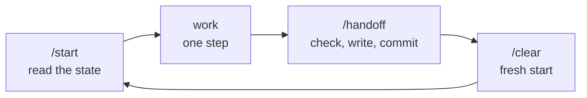

**English** · [Español](es/start-here.md)

# Level 0: Start here

Twelve words you will hear all the time, explained like a friend would. Five minutes. When you want the full
story, each one links to the official docs.

| Word | In plain words | Everyday example |
|---|---|---|
| **Repo** (repository) | A project folder that remembers every version of itself. | A notebook where you can flip back to any page you ever wrote. |
| **Commit** | A saved snapshot of the repo, with a short note saying what changed. | A photo of your desk with a sticky note: "finished the intro". |
| **Push** | Sending your commits from your computer to GitHub. | Uploading the photos to a shared album. Until you do, they only exist on your phone. |
| **Branch** | A parallel copy of the project where you try things without touching the main one. | Writing a draft on a separate sheet before copying it into the notebook. |
| **`.gitignore`** | A list of files git must never save. | The "do not pack" list before a trip: passport photocopies stay home. |
| **README** | The front page of your repo: what it is and how to use it. | The back cover of a book. |
| **`CLAUDE.md`** | The rules Claude reads at the start of every session in this project. | The note you leave the babysitter on the fridge. |
| **`PROGRESS.md`** | Where you are, what is done and what comes next. Claude's memory between sessions. | The bookmark, plus a sticky note saying "stopped at chapter 4, the twist is coming". |
| **Context** | Claude's working memory for one conversation. It fills up as you talk. | A whiteboard: when it is full, old notes get erased to make room. |
| **`/clear`** | Wipes the conversation and starts fresh. Files and commits are untouched. | Cleaning the whiteboard. The notebook (your repo) keeps everything. |
| **Hook** | A small script that runs before Claude uses a tool, and can say "no". | A bouncer checking every guest at the door. |
| **Permissions** | Lists of what Claude may do freely (`allow`), only after asking you (`ask`) or never (`deny`). | House rules: snacks yes, the car only if you ask, the safe never. |

## Why you never upload secrets

A **secret** is anything that lets someone act as you: passwords, API keys, tokens. They usually live in a file
called `.env`.

Once a secret is pushed to GitHub, assume it is stolen. Bots scan public repos for keys within minutes, and
deleting the file later does not help: git remembers every version. The only fix is to *rotate* the key
(create a new one, kill the old one).

So: `.env` goes in `.gitignore` from day one, and Claude is not even allowed to read it. This template does
both for you. [Dr. Repo](../README.md#already-have-a-project-let-dr-repo-take-a-look) checks it in any project.

## The cycle of a session

Every session follows the same loop. It is the whole method in one picture.

- **`/start`**: Claude reads `CLAUDE.md`, `PROGRESS.md` and git, tells you where you are, and waits.
- **Work**: one step, small enough to finish in this session.
- **`/handoff`**: Claude runs the checks, writes the state in `PROGRESS.md` and commits.
- **`/clear`**: a clean whiteboard for the next step.

## Official docs, when you want more

- Git: [git-scm.com/doc](https://git-scm.com/doc)
- GitHub: [docs.github.com/get-started](https://docs.github.com/en/get-started)
- Claude Code: [overview](https://docs.claude.com/en/docs/claude-code/overview),
  [CLAUDE.md and memory](https://docs.claude.com/en/docs/claude-code/memory),
  [settings and permissions](https://docs.claude.com/en/docs/claude-code/settings),
  [hooks](https://docs.claude.com/en/docs/claude-code/hooks)

Next: [Your first session in 10 steps](first-session.md).
